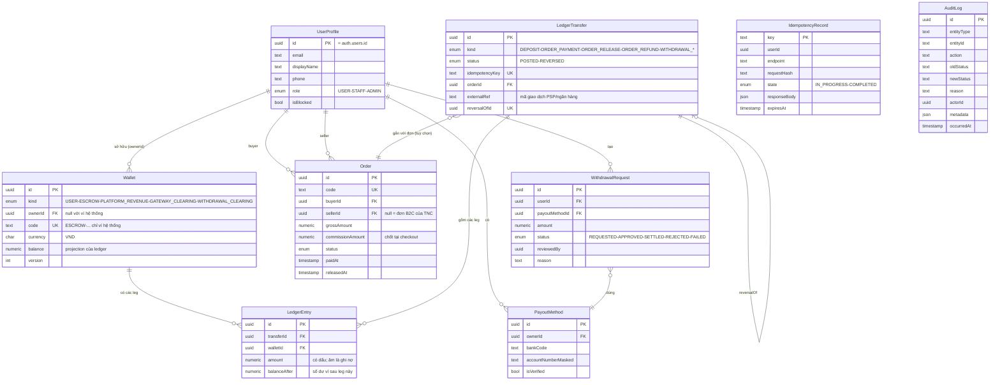

> ⚠️ **REVISION 2026-10-14 — mô hình bán hàng đã đổi sang Shopee.** Showroom không xử lý thanh toán; nút mua deep-link sang gian hàng Shopee; backend tập trung **đồng bộ dữ liệu mặt hàng với Shopee**. Các nội dung wallet/escrow/orders/payment trong tài liệu này thuộc mô hình cũ — thay thế bởi [SHOPEE_SHOWROOM_BACKEND.md](../../backend/SHOPEE_SHOWROOM_BACKEND.md).

# 05. Cơ sở dữ liệu

> Hướng dẫn kỹ thuật chi tiết (cột, constraint, câu lệnh vận hành) nằm tại
> [../../database/DATABASE.md](../../database/DATABASE.md). Chương này là mức
> đặc tả: mô hình dữ liệu, bất biến và chính sách thay đổi.

## 5.1. Tổng quan

| Hạng mục | Giá trị |
| -------- | ------- |
| Hệ quản trị | PostgreSQL (Supabase) |
| ORM | Prisma 6.x (pin `6.19.3`) - schema tại `prisma/schema.prisma` |
| Migration | `prisma/migrations/20261014053909_finance_core/migration.sql` (DDL + toàn bộ `prisma/sql/finance_guards.sql`) |
| Đơn vị tiền tệ | VND, số nguyên đồng, `NUMERIC(18,2)` |
| Trạng thái | ✅ Schema + guards đã áp dụng và được test trên PostgreSQL thật |

## 5.2. Mô hình dữ liệu



### Bảng dữ liệu và phạm vi sử dụng

| Bảng | Mục đích | Use case |
| ---- | -------- | -------- |
| `UserProfile` | Hồ sơ người dùng, mirror `auth.users`; nguồn của role nghiệp vụ | UC-01, tất cả |
| `Wallet` | Ví người dùng + 4 ví hệ thống; số dư là projection | UC-05, UC-08, UC-09 |
| `LedgerTransfer` | Một giao dịch tiền (2+ leg, tổng = 0) | Tất cả luồng tiền |
| `LedgerEntry` | Từng leg có dấu, kèm `balanceAfter`; append-only | Tất cả luồng tiền |
| `Order` | Đơn hàng B2C/C2C; số tiền và hoa hồng chốt tại checkout | UC-03, UC-04, UC-07, UC-08 |
| `PayoutMethod` | Tài khoản nhận tiền (che số) | UC-10 |
| `WithdrawalRequest` | Lệnh rút + vòng đời duyệt | UC-10 |
| `IdempotencyRecord` | Chống trùng cho endpoint không sinh transfer (⬜ chưa dùng) | Mọi endpoint POST |
| `AuditLog` | Audit trail thay đổi trạng thái | UC-06, UC-08, UC-10 |

Bảng catalog (category, product B2C, listing C2C, ảnh) **chưa có trong schema**
- sẽ bổ sung bằng migration mới khi làm module catalog/listing (⬜).

## 5.3. Quy tắc dữ liệu tiền tệ

1. Mọi cột tiền là `NUMERIC(18,2)`; giá trị VND phải là số nguyên đồng
   (constraint `ledger_entry_whole_dong` chặn phần lẻ).
2. Trong code TypeScript, tiền là `Prisma.Decimal` - không bao giờ là `number`
   (xem `src/common/money.ts`).
3. API trả số tiền dạng **chuỗi** (`"95000"`) để client không parse thành double.
4. Hoa hồng chỉ được làm tròn một lần (HALF_UP) tại `splitCommission()`;
   phần người bán nhận là phần còn lại, do đó tổng luôn khớp.
5. Số dư ví chỉ được cập nhật bởi `LedgerService.post()` bằng guarded UPDATE.

## 5.4. Bất biến và database guards

Toàn bộ nằm trong `prisma/sql/finance_guards.sql` và **đã được nhúng vào
migration** - chạy `prisma migrate deploy` là tự có:

| Guard | Loại | Bảo vệ điều gì |
| ----- | ---- | -------------- |
| `assert_transfer_balanced` | Deferred constraint trigger (COMMIT) | Mọi transfer ≥ 2 leg và tổng = 0 - không thể tạo/hủy tiền |
| `reject_ledger_mutation` | Trigger | `LedgerEntry` bất biến: cấm UPDATE/DELETE |
| `restrict_transfer_update` | Trigger | `LedgerTransfer` chỉ được đổi `status` |
| `wallet_user_balance_non_negative` | CHECK | Ví `USER` không bao giờ âm |
| `wallet_escrow_non_negative` | CHECK | Escrow không bao giờ âm |
| `wallet_owner_or_code` | CHECK | Ví user phải có owner; ví hệ thống phải có code |
| `ledger_entry_amount_not_zero` | CHECK | Leg 0 đồng là bug |
| `ledger_entry_whole_dong` | CHECK | Không có phần lẻ đồng |
| `order_amounts_sane` / `withdrawal_amount_positive` | CHECK | Số tiền đơn/lệnh rút hợp lệ, whole đồng |
| `@@unique([transferId, walletId])` | Unique | Một ví chỉ xuất hiện một lần trong transfer |
| `@@unique([ownerId, currency])` | Unique | Mỗi user một ví VND |
| RLS + revoke | Bảo mật | `anon`/`authenticated` không chạm được bảng tài chính |
| `handle_new_auth_user` | Trigger `auth.users` | Tự tạo UserProfile + ví khi đăng ký |
| `WalletReconciliation` | View | So số dư cache với ledger - nguồn cho job đối soát |
| `LedgerIntegrity` | View | Tổng toàn sổ cái phải bằng 0 |

## 5.5. Chính sách thay đổi schema

- Migration là **nguồn duy nhất** tạo/sửa schema; không dùng `db push` trên
  project thật, không sửa tay qua SQL editor.
- Không sửa migration đã áp dụng - thay đổi tiếp theo tạo migration mới.
- Sửa `finance_guards.sql` ⇒ phải đưa thay đổi tương ứng vào một migration mới
  (hoặc migration hiện có nếu chưa deploy đi đâu).
- Test suite chạy `prisma migrate deploy` trên database trống mỗi lần chạy ⇒
  migration hỏng là test đỏ ngay.
- Quy trình: sửa `schema.prisma` (hoặc SQL guards) → `npx prisma migrate dev
  --create-only --name <việc>` → review SQL → `prisma migrate deploy` (staging
  trước) → `prisma generate`.

## 5.6. Chính sách RLS cho dữ liệu công khai (khi thêm catalog)

Khi bổ sung bảng catalog/listing, muốn frontend đọc trực tiếp qua Supabase thì
đó phải là hành động tường minh, ví dụ:

```sql
grant select on public."Product" to anon, authenticated;
alter table public."Product" enable row level security;
create policy product_public_read on public."Product" for select using (true);
```

Mọi bảng liên quan tiền/đơn/lệnh rút **không bao giờ** được mở theo cách này.

## 5.7. Trạng thái và việc còn lại

| Hạng mục | Trạng thái |
| -------- | ---------- |
| Bảng tài chính + guards + views + seed ví hệ thống | ✅ |
| Trigger provisioning `auth.users` (có try/catch khi thiếu quyền) | ✅ (đã test trên PostgreSQL; trên Supabase chạy `migrate deploy` rồi kiểm tra) |
| Bảng catalog/listing/đơn hàng đầy đủ (items, shipping, ảnh, condition) | ⬜ migration mới |
| Job đối soát định kỳ + alert drift | ⬜ |
| `IdempotencyRecord` có service sử dụng | ⬜ |
