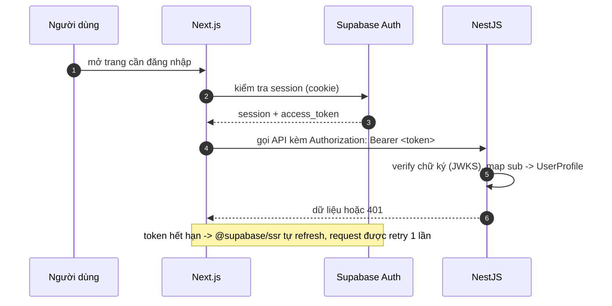

> ⚠️ **REVISION 2026-10-14 — mô hình bán hàng đã đổi sang Shopee.** Showroom không xử lý thanh toán; nút mua deep-link sang gian hàng Shopee; backend tập trung **đồng bộ dữ liệu mặt hàng với Shopee**. Các nội dung wallet/escrow/orders/payment trong tài liệu này thuộc mô hình cũ — thay thế bởi [SHOPEE_SHOWROOM_BACKEND.md](../../backend/SHOPEE_SHOWROOM_BACKEND.md).

# 07. Frontend (Next.js)

## 7.1. Stack và nguyên tắc

| Hạng mục | Lựa chọn | Ghi chú |
| -------- | -------- | ------- |
| Framework | Next.js (App Router, TypeScript) | SSR/ISR cho catalog, CSR cho khu vực tài khoản |
| Styling | Tailwind CSS | Design token tập trung, dark mode sau |
| UI kit | shadcn/ui (Radix) | Component copy-in, chủ động style |
| Data fetching | TanStack Query (React Query) | Cache + retry + trạng thái loading/error thống nhất |
| Auth client | `@supabase/ssr` | Cookie-based session, refresh tự động |
| Validation | zod + react-hook-form | Form đăng bán, rút tiền, checkout |
| Motion | framer-motion | Spring physics; tôn trọng `prefers-reduced-motion` |
| Ngôn ngữ thị giác | [frontend/FRONTEND_DESIGN_BRIEF.md](../../frontend/FRONTEND_DESIGN_BRIEF.md) | Editorial premium, soft cream + charcoal `#1A1A1A`, serif heading + sans UI |
| Tiền tệ | Bảng số hiển thị từ **chuỗi** API | Format `Intl.NumberFormat('vi-VN')` + hậu tố `₫` |

Nguyên tắc bất di bất dịch ở frontend:

1. **Không tính tiền ở client.** Mọi con số (tổng đơn, hoa hồng, số dư) là do
   backend trả về; client chỉ hiển thị.
2. **Không ghi database trực tiếp** (trừ dữ liệu người dùng thuần như profile
   hiển thị - và cả việc này cũng ưu tiên qua API).
3. Tiền hiển thị từ chuỗi, không `parseFloat` để tính.
4. Mọi POST tạo giao dịch mang `Idempotency-Key` sinh một lần cho mỗi lần bấm
   (uuid v4) - retry mạng dùng lại key cũ, lần bấm mới sinh key mới.

## 7.2. Bản đồ route (trạng thái hiện tại)

| Route | Màn hình | Actor | Nguồn dữ liệu |
| ----- | -------- | ----- | -------------- |
| `/` | Trang chủ showroom, bộ sưu tập, sản phẩm nổi bật và thông tin kiểm định | Guest · ✅ | Catalog API |
| `/san-pham` | Catalog hai collection, lọc/tìm kiếm và tải thêm theo cursor | Guest · ✅ | `GET /catalog/collections`, `GET /catalog/products` |
| `/san-pham/[slug]` | PDP với ảnh, giá tham khảo, tình trạng, QA và CTA sang Shopee | Guest · ✅ | `GET /catalog/products/{slug}`, `GET .../buy` |
| `/anh-tu-lieu` | Nguồn ảnh tư liệu sử dụng trên showroom | Guest · ✅ | Tĩnh |
| `/van-hanh` | Quản lý import Shopee, sync runs và curation sản phẩm | Staff · ⬜ | Admin API hiện có; frontend staff chưa có |
| `/tai-khoan`, `/(auth)/*` | Hồ sơ và đăng nhập Supabase | User/Guest · ⬜ | `GET /me`, Supabase Auth |

Các luồng ví, checkout nội bộ, đơn hàng và seller listing thuộc mô hình cũ;
không nằm trong route plan của showroom hiện tại.

## 7.3. Auth và phiên làm việc



- Route bảo vệ bằng middleware (kiểm tra session + role cho `/duyet`, `/van-hanh`).
- Role nghiệp vụ (STAFF/ADMIN) **không** đọc từ JWT claim phía client để quyết
  định UI nhạy cảm; UI ẩn nút nhưng backend vẫn là nơi từ chối thật sự.
- 401 từ API ⇒ refresh session; refresh fail ⇒ chuyển về `/dang-nhap?next=...`.

## 7.4. API client

- Một module `lib/api.ts` duy nhất: base URL từ `NEXT_PUBLIC_API_URL`, tự gắn
  token, tự sinh `Idempotency-Key` khi POST có cờ.
- Mapping lỗi: mọi lỗi backend theo RFC 7807 (`application/problem+json`) với
  `code`; frontend giữ bảng dịch `code` → thông điệp tiếng Việt:

| `code` | Thông điệp UI |
| ------ | ------------- |
| `INSUFFICIENT_FUNDS` | "Số dư ví không đủ. Nạp thêm để tiếp tục." + nút mở drawer nạp tiền |
| `INVALID_STATE_TRANSITION` | "Đơn hàng vừa thay đổi trạng thái, tải lại để xem." |
| `ESCROW_EMPTY` / `ALREADY_REVERSED` | Thông báo chung + hướng dẫn liên hệ hỗ trợ |
| 409 idempotency clash | "Yêu cầu trùng, hệ thống đang xử lý..." |

- Retry: chỉ retry GET và các POST idempotent với **cùng** `Idempotency-Key`;
  4xx không retry.
- Không cache dữ liệu tiền tệ quá 30 s; invalidate ngay sau thao tác tiền.

## 7.5. Đặc tả màn hình chính

### 7.5.1. Checkout (B2C + C2C)

- Bước 1: xác nhận giỏ (giá, phí ship dự kiến, tổng - số từ API).
- Bước 2: chọn phương thức: ví (khả dụng khi đủ số dư) hoặc nạp QR.
- Bước 3: xác nhận ⇒ `POST /orders` (Idempotency-Key) ⇒ `POST /orders/{id}/pay-wallet`.
- Thành công: Dialog shadcn "Đặt hàng thành công 🎉" + link xem đơn (theo yêu cầu
  sản phẩm); thất bại: hiển thị `code` đã dịch, cho thử lại với key mới.
- Đơn C2C hiển thị rõ: "Tiền được giữ an toàn đến khi bạn xác nhận đã nhận hàng."

### 7.5.2. Ví

- Thẻ số dư + nút Nạp/Rút; sổ giao dịch phân trang cursor ("Tải thêm").
- Mỗi dòng sổ: loại giao dịch, mô tả, số tiền có dấu, số dư sau, thời điểm
  (hiển thị `Asia/Ho_Chi_Minh`).
- Nạp tiền: tạo top-up ⇒ hiển thị QR + nội dung chuyển khoản + đếm ngược; poll
  trạng thái mỗi 3 s đến khi cộng tiền hoặc hết hạn.

### 7.5.3. Đăng bán second-hand

- Form: ảnh (kéo-thả, tối đa 10), tên sản phẩm (chọn từ danh mục hoặc nhập),
  tình trạng (% đã dùng), hạn dùng còn lại, giá, mô tả, ảnh chứng minh mua hàng.
- Validate zod; upload ảnh trước khi submit listing (signed URL).
- Sau submit: trạng thái `PENDING_REVIEW`; hiển thị rõ "đang chờ duyệt" và lý
  do nếu bị từ chối để sửa và gửi lại.

### 7.5.4. Khu vực staff

- Hàng chờ duyệt: ảnh lớn, checklist (chính hãng?, hạn dùng?, ảnh chứng minh?),
  nút Duyệt / Từ chối (bắt buộc lý do).
- Lệnh rút: thông tin che một phần số tài khoản, số dư hiện tại của user, nút
  Duyệt / Từ chối; sau khi ngân hàng chạy: Settle / Báo thất bại.
- Đơn hàng: danh sách DELIVERED chờ release, nút Release / Refund (kèm lý do).

## 7.6. Hệ thống UI

### 7.6.1. Ngôn ngữ thị giác (tóm tắt - chi tiết ở design brief)

| Quy tắc | Giá trị |
| ------- | ------- |
| VISUAL_DENSITY | Low - 2-3 sản phẩm/hàng desktop, nhiều khoảng thở |
| MOTION_INTENSITY | Medium - spring physics, không linear easing dài dòng |
| DESIGN_VARIANCE | Medium-High - hero/banner phá cách; checkout/ví giữ grid chuẩn |
| Màu | Nền cream/beige ấm, chữ charcoal `#1A1A1A`, 1 màu accent, không gradient tím/xanh |
| Chữ | Serif cho heading (Playfair Display), sans cho UI |
| Badge tình trạng | Typographic badge (`[New In Box]`, `[95% Left · Box Damaged]`, `[Swatched Once]`), không banner chói |
| Second-hand card | Micro progress bar "còn lại %" + nhãn tình trạng; gallery PDP có zoom |

Chi tiết đầy đủ + prompt mẫu cho AI agent: [frontend/FRONTEND_DESIGN_BRIEF.md](../../frontend/FRONTEND_DESIGN_BRIEF.md).

| Thành phần | shadcn/ui | Ghi chú |
| ---------- | --------- | ------- |
| Form & validation | `form`, `input`, `select`, `textarea`, `checkbox` | zod resolver, thông báo lỗi tiếng Việt |
| Phản hồi | `toast` (sonner), `alert`, `dialog`, `alert-dialog` | Dialog xác nhận cho hành động tiền tệ |
| Danh sách | `table` (staff), `card`, `badge` (trạng thái), `skeleton` | Badge màu theo trạng thái đơn/duyệt |
| Điều hướng | `navigation-menu`, `breadcrumb`, `tabs` | Tab "Đơn mua / Đơn bán" |
| Số liệu | `progress`, `separator`, `scroll-area` | Micro progress bar "% còn lại" của listing second-hand (cao ~4px) |

Trạng thái bắt buộc cho mọi màn hình có API: **loading** (skeleton), **empty**
(minh hoạ + CTA), **error** (thông điệp từ `code` + nút thử lại).

## 7.7. Hiệu năng và SEO

- Catalog: SSR/ISR (revalidate 60 s), metadata động cho chi tiết sản phẩm.
- Ảnh: `next/image` trỏ CDN Supabase Storage; kích thước gốc tối đa 1600 px;
  `loading="lazy"` ngoài viewport đầu.
- Bundle: route-based code splitting mặc định; khu vực staff lazy-load riêng.
- Core Web Vitals mục tiêu: LCP < 2.5 s (4G), CLS < 0.1.

## 7.8. Cấu trúc thư mục đề xuất

```text
frontend/
  app/
    (public)/            # trang chủ, catalog, chi tiết
    (auth)/              # đăng nhập, đăng ký, quên mật khẩu
    (account)/           # vi, đơn hàng, tài khoản
    (seller)/dang-ban/
    (staff)/duyet/, van-hanh/
    api/                 # route handlers nếu cần proxy (mặc định không cần)
  components/ui/         # shadcn
  components/domain/     # product-card, order-timeline, wallet-statement...
  lib/                   # api.ts, supabase clients, format.ts
  hooks/                 # use-wallet, use-orders...
```

## 7.9. Trạng thái

| Hạng mục | Trạng thái |
| -------- | ---------- |
| Public storefront | ✅ Trang chủ, catalog, PDP, collection tabs, giá tham khảo, CTA Shopee |
| API client | ✅ Catalog API + xử lý RFC 7807 code |
| Staff/admin frontend | ⬜ Chưa có màn import, lịch sử sync, curation/publish |
| Auth/account frontend | ⬜ Chưa tích hợp luồng đăng nhập/session vào UI |
| Phụ thuộc backend | 🟨 Catalog/curation API có; Affiliate S4 đang hoàn thiện; Open Platform S5 phụ thuộc phê duyệt Shopee |
| Design brief | ✅ [frontend/FRONTEND_DESIGN_BRIEF.md](../../frontend/FRONTEND_DESIGN_BRIEF.md) đã chốt (2026-10-14) |
