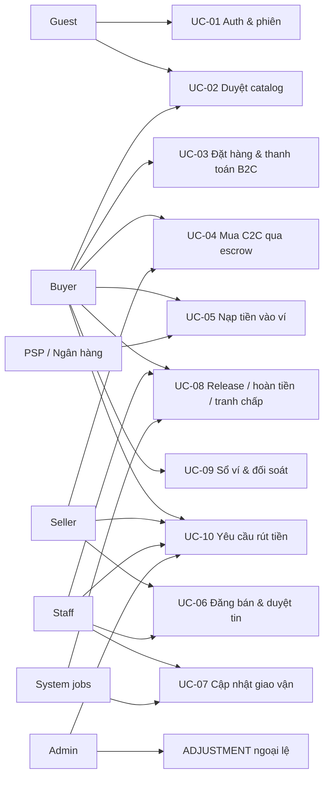

> ⚠️ **REVISION 2026-10-14 — mô hình bán hàng đã đổi sang Shopee.** Showroom không xử lý thanh toán; nút mua deep-link sang gian hàng Shopee; backend tập trung **đồng bộ dữ liệu mặt hàng với Shopee**. Các nội dung wallet/escrow/orders/payment trong tài liệu này thuộc mô hình cũ — thay thế bởi [SHOPEE_SHOWROOM_BACKEND.md](../../backend/SHOPEE_SHOWROOM_BACKEND.md).

# 10. Use case chi tiết

## 10.1. Tổng quan

Chương này đặc tả 10 use case (UC-01 → UC-10) của TNC Web Platform: actor,
điều kiện, luồng chính, luồng thay thế, quy tắc nghiệp vụ và liên kết tới yêu
cầu chức năng ([08_Functional_Requirement.md](08_Functional_Requirement.md)) và
API ([11_API_Specification.md](11_API_Specification.md)).

Trạng thái ghi theo quy ước tại [README.md](../../README.md). Trong đó các luồng
tiền cốt lõi (thanh toán escrow, release/refund, nạp tiền, duyệt rút) **đã được
hiện thực ở tầng service và kiểm chứng bằng test** - phần còn thiếu là tầng
HTTP để use case chạy end-to-end từ giao diện.

## 10.2. Actor

| Actor | Loại | Mô tả |
| ----- | ---- | ----- |
| Guest | Người | Khách chưa đăng nhập; chỉ xem catalog/listing đã duyệt |
| Buyer | Người | Tài khoản đã đăng nhập; mua hàng, nạp/rút tiền, mở tranh chấp |
| Seller | Người | Buyer có đăng bán second-hand; quản lý tin, nhận tiền sau hoàn tất |
| Staff | Người | Nhân viên TNC: duyệt tin, cập nhật giao vận, xử lý release/refund, duyệt rút |
| Admin | Người | Toàn quyền staff + quản lý catalog, điều chỉnh sổ ngoại lệ (ADJUSTMENT), cấu hình |
| Supabase Auth | Hệ thống | Đăng ký/đăng nhập, phát hành JWT, trigger provisioning |
| PSP / Ngân hàng | Hệ thống ngoài | Nhận nạp tiền, gọi webhook, chi trả lệnh rút |
| System (jobs) | Hệ thống | Hết hạn giữ chỗ, auto-release escrow, đối soát drift |

## 10.3. Sơ đồ use case

## 10.4. Danh sách use case

| ID | Tên | Actor chính | Độ ưu tiên | Trạng thái tổng thể |
| -- | --- | ----------- | ---------- | ------------------- |
| UC-01 | Đăng ký, đăng nhập và phiên làm việc | Guest, mọi user | Bắt buộc | ⬜ (trigger provisioning ✅ trong migration) |
| UC-02 | Duyệt catalog và xem chi tiết sản phẩm | Guest, Buyer | Bắt buộc | ⬜ |
| UC-03 | Đặt hàng và thanh toán đơn B2C bằng ví | Buyer | Bắt buộc | 🟨 (thanh toán ✅ service + test; order/HTTP ⬜) |
| UC-04 | Mua mỹ phẩm second-hand qua escrow | Buyer | Bắt buộc | 🟨 (escrow ✅ service + test; listing/HTTP ⬜) |
| UC-05 | Nạp tiền vào ví qua PSP | Buyer, Seller | Bắt buộc | 🟨 (`confirmDeposit` ✅ + test; topup intent + webhook ⬜) |
| UC-06 | Đăng bán second-hand và duyệt tin | Seller, Staff | Bắt buộc | ⬜ |
| UC-07 | Cập nhật trạng thái giao vận đơn | Staff, Buyer | Bắt buộc | ⬜ |
| UC-08 | Release escrow, hoàn tiền và tranh chấp | Staff, Buyer, System | Bắt buộc | 🟨 (release/refund ✅ service + test; workflow/job ⬜) |
| UC-09 | Xem sổ ví và đối soát | Buyer, Seller, Admin | Bắt buộc | 🟨 (`getStatement`/`findBalanceDrift` ✅; HTTP ⬜) |
| UC-10 | Yêu cầu rút tiền và duyệt chi | Buyer, Seller, Staff, Admin | Bắt buộc | 🟨 (approve/settle/fail ✅ service + test; endpoint/audit ⬜) |

---

## 10.5. UC-01: Đăng ký, đăng nhập và phiên làm việc

| Mục | Giá trị |
| --- | ------- |
| Actor chính | Guest → mọi vai trò |
| Actor phụ | Supabase Auth, NestJS (provisioning đọc role) |
| Trigger | Người dùng mở trang cần tài khoản, hoặc bấm Đăng nhập/Đăng ký |
| Preconditions | Chưa có session hợp lệ trong trình duyệt |
| Postconditions (thành công) | Session JWT hợp lệ; `UserProfile` và ví VND tồn tại (tạo tự động lúc đăng ký); UI điều hướng theo vai trò |
| Postconditions (thất bại) | Không có session; thông báo lỗi phù hợp; tài khoản `isBlocked` không thực hiện được thao tác tiền |
| Độ ưu tiên | Bắt buộc |
| Trạng thái | ⬜ (trigger `handle_new_auth_user` ✅ đã có trong migration) |
| FR liên quan | FR-01, FR-02, FR-03, FR-04 |
| API liên quan | Supabase Auth SDK; `GET /api/v1/me` |
| Bảng dữ liệu | `UserProfile`, `Wallet` |

**Luồng chính**

1. Người dùng mở trang đăng nhập/đăng ký.
2. Chọn phương thức: email + mật khẩu, hoặc OAuth (Google, Facebook).
3. Supabase Auth xác thực và phát hành JWT (ES256/RS256).
4. Nếu là đăng ký: trigger `on_auth_user_created` tạo `UserProfile` + ví VND
   (`kind = USER`, `currency = VND`, số dư 0).
5. Frontend lưu session (cookie qua `@supabase/ssr`) và gọi `GET /me`.
6. NestJS verify JWT qua JWKS, map `sub` → `UserProfile`, trả role thực tế.
7. UI điều hướng: user thường → catalog; STAFF/ADMIN → thêm khu vực vận hành.

**Luồng thay thế / ngoại lệ**

| Mã | Tình huống | Xử lý |
| -- | ---------- | ----- |
| A1 | Quên mật khẩu | Gửi email reset qua Supabase; không tiết lộ email có tồn tại hay không |
| A2 | Phiên hết hạn giữa chừng | `@supabase/ssr` refresh token; refresh thất bại → 401 → chuyển `/dang-nhap?next=...` |
| A3 | Tài khoản `isBlocked` | Vẫn xem được lịch sử; mọi endpoint tiền trả 403 kèm hướng dẫn liên hệ hỗ trợ (FR-04) |
| A4 | Role bị đổi bởi admin | Có hiệu lực ngay ở lần gọi API kế tiếp (role đọc từ DB, không cache trong JWT) |

**Quy tắc nghiệp vụ**

- BR-UC01-1: Role nghiệp vụ chỉ đọc từ `UserProfile.role`; không bao giờ tin
  claim phía client (FR-03).
- BR-UC01-2: Backend không tự parse JWT; chỉ verify chữ ký qua JWKS (FR-02).
- BR-UC01-3: Mỗi user có đúng một ví VND, tạo một lần lúc đăng ký (FR-28).

---

## 10.6. UC-02: Duyệt catalog và xem chi tiết sản phẩm

| Mục | Giá trị |
| --- | ------- |
| Actor chính | Guest, Buyer |
| Actor phụ | NestJS (catalog), Supabase Storage (CDN ảnh) |
| Trigger | Mở trang chủ/catalog hoặc bấm vào sản phẩm |
| Preconditions | Không cần đăng nhập |
| Postconditions (thành công) | Danh sách/chi tiết hiển thị đúng: giá (chuỗi), tồn kho khả dụng, ảnh, tình trạng C2C |
| Postconditions (thất bại) | Trạng thái empty/error rõ ràng, có nút thử lại |
| Độ ưu tiên | Bắt buộc |
| Trạng thái | ⬜ (module catalog chưa có) |
| FR liên quan | FR-05, FR-06, FR-07, FR-09 |
| API liên quan | `GET /api/v1/products`, `GET /api/v1/products/{id}` |
| Bảng dữ liệu | Catalog tables (⬜ migration mới), Supabase Storage |

**Luồng chính**

1. Người dùng mở `/` hoặc `/san-pham`.
2. Frontend gọi `GET /products` kèm bộ lọc (loại B2C/C2C, danh mục, khoảng
   giá, tình trạng) và cursor phân trang.
3. Hệ thống chỉ trả sản phẩm đang bán và listing đã duyệt (`APPROVED`).
4. Người dùng mở chi tiết: giá, tồn kho khả dụng, mô tả, ảnh CDN; riêng C2C
   thêm % đã dùng, hạn dùng còn lại, ảnh chứng minh mua hàng.
5. CTA "Mua ngay": guest được đưa tới đăng nhập trước khi checkout.

**Luồng thay thế / ngoại lệ**

| Mã | Tình huống | Xử lý |
| -- | ---------- | ----- |
| A1 | Sản phẩm/listing hết hàng hoặc `SOLD` | Badge "Hết hàng"; nút mua bị vô hiệu; listing SOLD biến khỏi catalog (FR-20) |
| A2 | Listing chưa/không được duyệt | Không bao giờ xuất hiện với guest (FR-17) |
| A3 | Flash sale | Hiển thị giá sale theo khung giờ; tồn kho vẫn bảo vệ bằng guarded update khi mua (FR-07, FR-08) |

**Quy tắc nghiệp vụ**

- BR-UC02-1: Giá trả về là chuỗi để client không parse thành double; client chỉ
  hiển thị, không tính toán (05 mục 5.3).
- BR-UC02-2: Ảnh phục vụ qua CDN Supabase Storage, đường dẫn do backend quyết
  định (FR-09).

---

## 10.7. UC-03: Đặt hàng và thanh toán đơn B2C bằng ví

| Mục | Giá trị |
| --- | ------- |
| Actor chính | Buyer |
| Actor phụ | NestJS (order + banking), System (job hết hạn) |
| Trigger | Bấm "Đặt hàng" ở trang checkout |
| Preconditions | Đã đăng nhập; giỏ hàng hợp lệ; sản phẩm còn tồn kho; ví VND tồn tại |
| Postconditions (thành công) | Đơn `PENDING_PAYMENT` rồi `PAID`; tồn kho trừ đúng; tiền nằm trong `ESCROW`; có transfer `ORDER_PAYMENT` |
| Postconditions (thất bại) | Không trừ tiền, không giữ tồn kho vĩnh viễn; đơn `CANCELLED` khi hết hạn; lỗi có `code` rõ ràng |
| Độ ưu tiên | Bắt buộc |
| Trạng thái | 🟨 (`payForOrder` ✅ + test concurrency; order module/HTTP ⬜) |
| FR liên quan | FR-10, FR-11, FR-12, FR-13, FR-14, FR-15 |
| API liên quan | `POST /orders`, `POST /orders/{id}/pay-wallet`, `POST /orders/{id}/cancel` |
| Bảng dữ liệu | `Order`, `Wallet`, `LedgerTransfer`, `LedgerEntry` |

**Luồng chính**

1. Buyer bấm "Đặt hàng"; frontend sinh `Idempotency-Key` (uuid v4) cho lần bấm
   này và gọi `POST /orders`.
2. NestJS mở transaction ngắn: kiểm tra tồn kho bằng guarded update
   (`WHERE stock >= qty`), tạo `Order` trạng thái `PENDING_PAYMENT`, chốt
   `commissionAmount` từ `APP_COMMISSION_BPS`, đặt hạn giữ chỗ
   `APP_RESERVATION_MINUTES`.
3. UI hiển thị đơn + số dư ví; buyer chọn "Thanh toán bằng ví".
4. Frontend gọi `POST /orders/{id}/pay-wallet` (kèm `Idempotency-Key`).
5. NestJS mở một transaction duy nhất:
   - trừ ví buyer: `buyer -gross`;
   - cộng escrow: `ESCROW +gross`;
   - cập nhật tồn kho/`Order.status = PAID`, `paidAt = now()`.
6. Ledger ghi transfer `ORDER_PAYMENT` với khoá `order-payment:{orderId}`.
7. UI hiển thị dialog thành công (shadcn) + link xem đơn.

**Luồng thay thế / ngoại lệ**

| Mã | Tình huống | Xử lý |
| -- | ---------- | ----- |
| A1 | Ví không đủ tiền | 409 `INSUFFICIENT_FUNDS`; UI gợi ý nạp tiền (drawer top-up); không có bút toán nào |
| A2 | Hết hàng khi tạo đơn | 409 `OUT_OF_STOCK`; UI tải lại tồn kho |
| A3 | Quá hạn giữ chỗ | Job (mỗi phút) chuyển đơn `CANCELLED`, trả tồn kho, ghi audit (FR-11) |
| A4 | Double-click / retry mạng | Cùng `Idempotency-Key` và/hoặc cùng khoá ledger ⇒ replay kết quả cũ, **không** trừ tiền lần hai |
| A5 | Buyer hủy khi còn `PENDING_PAYMENT` | `POST /orders/{id}/cancel`; trả tồn kho; audit (FR-14) |
| A6 | Thanh toán thất bại giữa chừng | Transaction rollback toàn bộ: tiền, trạng thái, tồn kho đều nguyên vẹn |

**Quy tắc nghiệp vụ**

- BR-UC03-1: Hoàn tất mua ≤ 3 phút với người dùng phổ thông (Objective 1).
- BR-UC03-2: Hoa hồng chốt tại checkout, lưu trên đơn; đổi tỷ lệ sau không ảnh
  hưởng đơn cũ (FR-13).
- BR-UC03-3: Đơn B2C có `sellerId = NULL` (TNC là người bán); khi release, toàn
  bộ tiền escrow về `PLATFORM_REVENUE`.
- BR-UC03-4: Kiểm tra tiền và ghi tiền là **một** câu UPDATE có điều kiện; hai
  người mua đồng thời không thể cùng "thấy đủ tiền" (06 mục 6.3.3).

---

## 10.8. UC-04: Mua mỹ phẩm second-hand qua escrow

| Mục | Giá trị |
| --- | ------- |
| Actor chính | Buyer |
| Actor phụ | Seller, Staff (giao vận/release), System (auto-release) |
| Trigger | Buyer mua listing C2C đã duyệt |
| Preconditions | Listing `APPROVED`, `qty = 1`, chưa bán; buyer đăng nhập; ví đủ tiền hoặc nạp trước |
| Postconditions (thành công) | Đơn `PAID`; listing `SOLD`; tiền trong `ESCROW`; sau `DELIVERED` release chia hoa hồng; đơn `COMPLETED` |
| Postconditions (thất bại) | Không trừ tiền; listing còn nguyên trạng thái có thể mua |
| Độ ưu tiên | Bắt buộc |
| Trạng thái | 🟨 (escrow ✅ service + test "escrow isolation"; listing/HTTP ⬜) |
| FR liên quan | FR-20, FR-23, FR-24, FR-25, FR-26, FR-27, FR-39, FR-40 |
| API liên quan | `POST /orders`, `POST /orders/{id}/pay-wallet`, `POST /orders/{id}/dispute` |
| Bảng dữ liệu | `Order` (sellerId ≠ NULL), `Wallet` (ESCROW), `LedgerTransfer` |

**Luồng chính**

1. Buyer mở listing đã duyệt và bấm "Mua an toàn" (thấy rõ "Tiền được giữ đến
   khi bạn xác nhận đã nhận hàng").
2. `POST /orders` với `Idempotency-Key`: giữ chỗ listing (guarded update chuyển
   sang `RESERVED`/giữ chỗ) + tạo đơn `PENDING_PAYMENT`.
3. `POST /orders/{id}/pay-wallet`: một transaction gồm:
   - `buyer -gross`;
   - `ESCROW +gross`;
   - listing → `SOLD`;
   - order → `PAID`.
4. Seller đóng gói, gửi hàng (ngoài hệ thống); staff cập nhật
   `READY_TO_SHIP → SHIPPED → DELIVERED` (UC-07), hoặc buyer bấm "Đã nhận hàng".
5. Release escrow (staff bấm, hoặc job auto-release sau
   `APP_AUTO_RELEASE_DAYS` ngày kể từ `DELIVERED` nếu không có tranh chấp):
   - `ESCROW -gross`;
   - `seller +(gross − commission)`;
   - `PLATFORM_REVENUE +commission`;
   - order → `COMPLETED`, `releasedAt = now()`.
6. Seller thấy số dư ví tăng; hai bên nhận thông báo.

**Luồng thay thế / ngoại lệ**

| Mã | Tình huống | Xử lý |
| -- | ---------- | ----- |
| A1 | Hai buyer cùng mua một món | Guarded update + idempotency ⇒ đúng một người thắng; người sau nhận 409 `OUT_OF_STOCK`/`INVALID_STATE_TRANSITION`, không mất tiền |
| A2 | Buyer mở tranh chấp trước release | Đơn → `DISPUTED`; auto-release dừng; staff xử lý (UC-08) |
| A3 | Buyer không bấm xác nhận, không mở tranh chấp | Auto-release sau N ngày (mặc định đề xuất 3 - cần chốt) |
| A4 | Giao hàng thất bại | Staff ghi chú + liên hệ; nếu không giao được, xử lý như refund theo chính sách |
| A5 | Double-release | Khoá `order-release:{orderId}` ⇒ replay, không trả hai lần |

**Quy tắc nghiệp vụ**

- BR-UC04-1: Một listing chỉ bán một lần; trạng thái `SOLD` cập nhật trong
  **cùng** transaction với bút toán (FR-23).
- BR-UC04-2: Escrow là ví dùng chung cho mọi đơn, nên release/refund phải đối
  chiếu riêng phần tiền của **chính đơn đó** (`assertEscrowHolds`), không dùng
  số dư tổng - đã có test "escrow isolation" chứng minh (FR-27).
- BR-UC04-3: Release chỉ hợp lệ khi đơn `DELIVERED`; refund chỉ khi tiền còn
  trong escrow (`PAID..DISPUTED`). Sau `COMPLETED`, hoàn tiền tự động bị từ chối
  (FR-26) - ngoại lệ phải là `ADJUSTMENT` do Admin tạo (FR-41).
- BR-UC04-4: Khi refund, đề xuất đưa listing về `APPROVED` để bán lại (có
  audit) hoặc staff ẩn nếu hàng hoàn không còn bán được - cần chốt khi làm
  module listing.

---

## 10.9. UC-05: Nạp tiền vào ví qua PSP

| Mục | Giá trị |
| --- | ------- |
| Actor chính | Buyer, Seller |
| Actor phụ | PSP/ngân hàng (PayOS, VietQR; Stripe dự phòng), System (webhook) |
| Trigger | Người dùng bấm "Nạp tiền" và chọn mệnh giá |
| Preconditions | Đã đăng nhập; tài khoản không `isBlocked` |
| Postconditions (thành công) | Ví `+a` với transfer `DEPOSIT`; top-up `COMPLETED`; số dư hiển thị cập nhật |
| Postconditions (thất bại) | Top-up `EXPIRED`/`FAILED`; ví không đổi; tiền chuyển thừa/sai nội dung xử lý ngoài luồng |
| Độ ưu tiên | Bắt buộc |
| Trạng thái | 🟨 (`confirmDeposit` ✅ + test replay/race; endpoint + webhook ⬜) |
| FR liên quan | FR-28, FR-29, FR-30, FR-31 |
| API liên quan | `POST /wallet/topups`, `GET /wallet/topups/{id}`, `POST /webhooks/payments/{provider}` |
| Bảng dữ liệu | `Wallet` (GATEWAY_CLEARING), `LedgerTransfer` (DEPOSIT) |

**Luồng chính**

1. Người dùng bấm "Nạp tiền" → `POST /wallet/topups` với số tiền
   (`Idempotency-Key`).
2. NestJS tạo payment intent với PSP, trả về QR + thông tin chuyển khoản + mã
   tham chiếu (`gatewayRef`); UI hiển thị kèm đếm ngược (đề xuất 15 phút - cần
   chốt, phụ thuộc PSP).
3. Người dùng chuyển khoản đúng số tiền và nội dung.
4. PSP gọi webhook `POST /webhooks/payments/{provider}`.
5. NestJS đọc **raw body**, verify chữ ký; sai chữ ký ⇒ 401 + log an toàn.
6. NestJS đọc `amount`, `gatewayRef`, `userId` từ payload **đã verify**, gọi
   `BankingService.confirmDeposit()` - idempotent theo `deposit:{gatewayRef}`:
   - `GATEWAY_CLEARING -a`;
   - `user +a`.
7. UI poll `GET /wallet/topups/{id}` (mỗi 3 s) thấy `COMPLETED` → hiển thị số
   dư mới + toast thành công.

**Luồng thay thế / ngoại lệ**

| Mã | Tình huống | Xử lý |
| -- | ---------- | ----- |
| A1 | Webhook PSP retry (tuần tự hoặc song song) | Replay idempotent: cộng tiền **đúng một lần** (đã test replay ×3 + race ×3) |
| A2 | Chữ ký không hợp lệ | 401; không cộng tiền; alert nếu lặp lại nhiều lần |
| A3 | Người dùng không chuyển tiền | Top-up hết hạn; không có bút toán |
| A4 | Chuyển sai nội dung/số tiền | Không tự cộng; đối soát thủ công qua ADMIN (ADJUSTMENT có audit) |
| A5 | Client cố giả số tiền | Bị bỏ qua hoàn toàn: số tiền chỉ lấy từ webhook đã verify (FR-29) |

**Quy tắc nghiệp vụ**

- BR-UC05-1: `GATEWAY_CLEARING` được phép âm; số dư âm của nó đúng bằng tổng
  tiền đã nạp vào hệ thống, dùng để đối chiếu sao kê PSP.
- BR-UC05-2: Mọi bút toán nạp tiền là transfer 2 leg tổng bằng 0; retry không
  bao giờ tạo transfer thứ hai (FR-30, FR-31).
---

## 10.10. UC-06: Đăng bán second-hand và duyệt tin

| Mục | Giá trị |
| --- | ------- |
| Actor chính | Seller, Staff |
| Actor phụ | Supabase Storage (ảnh), System (nhắc duyệt) |
| Trigger | Seller bấm "Đăng bán"; Staff mở hàng chờ duyệt |
| Preconditions | Seller đã đăng nhập; ảnh hợp lệ (≤ 5 MB/ảnh, ≤ 10 ảnh - mặc định tạm) |
| Postconditions (thành công) | Listing `APPROVED` hiển thị công khai; có audit cho cả approve và reject |
| Postconditions (thất bại) | Listing `REJECTED` kèm lý do; seller sửa và gửi lại được |
| Độ ưu tiên | Bắt buộc |
| Trạng thái | ⬜ (module listing chưa có) |
| FR liên quan | FR-16, FR-17, FR-18, FR-19, FR-20, FR-21, FR-22, FR-42 |
| API liên quan | `POST /listings`, `GET /listings/mine`, `PATCH /listings/{id}`, `GET /staff/listings`, `POST /staff/listings/{id}/approve`, `POST /staff/listings/{id}/reject` |
| Bảng dữ liệu | Listing tables (⬜ migration mới), `AuditLog` |

**Luồng chính**

1. Seller mở `/dang-ban`, điền: chọn sản phẩm/danh mục, giá, % đã dùng, hạn
   dùng còn lại, mô tả, ảnh chụp + ảnh chứng minh mua hàng (hoá đơn/hộp).
2. Frontend xin signed URL và upload ảnh lên Supabase Storage (đường dẫn do
   backend quyết định).
3. `POST /listings` (Idempotency-Key) → listing ở `PENDING_REVIEW`; UI hiển thị
   "Đang chờ duyệt".
4. Staff mở `/duyet` (`GET /staff/listings?status=PENDING_REVIEW`), kiểm tra
   theo checklist (chính hãng?, hạn dùng?, ảnh chứng minh?, giá hợp lý?).
5. Staff bấm **Duyệt** → `APPROVED` (audit: actor, thời điểm, old → new) sau đó
   hiển thị công khai.
6. Nếu **Từ chối** → bắt buộc nhập lý do; `REJECTED` (audit); seller thấy lý do
   và có thể sửa rồi gửi lại (quay lại bước 3 với trạng thái `PENDING_REVIEW`).

**Luồng thay thế / ngoại lệ**

| Mã | Tình huống | Xử lý |
| -- | ---------- | ----- |
| A1 | Seller sửa listing đã duyệt | Nội dung thay đổi ⇒ quay lại `PENDING_REVIEW` (FR-19) |
| A2 | Staff ẩn listing đã duyệt | `HIDDEN` + lý do + audit; biến khỏi catalog ngay |
| A3 | Listing đã bán (`SOLD`) | Không sửa được; chỉ xem lịch sử |
| A4 | Upload ảnh lỗi giữa chừng | Listing chưa submit; UI cho retry upload, không tạo rác trong DB |

**Quy tắc nghiệp vụ**

- BR-UC06-1: Không có listing nào hiển thị công khai trước khi được duyệt
  (FR-17) - kể cả qua API trực tiếp.
- BR-UC06-2: Mọi thay đổi trạng thái listing ghi `AuditLog` trong cùng
  transaction (FR-42).
- BR-UC06-3: Ảnh lưu trên Storage với đường dẫn `listings/{userId}/{uuid}` do
  backend sinh; client không tự chọn đường dẫn (FR-09).

---

## 10.11. UC-07: Cập nhật trạng thái giao vận đơn

| Mục | Giá trị |
| --- | ------- |
| Actor chính | Staff |
| Actor phụ | Buyer (xác nhận đã nhận), System (timeline/notify) |
| Trigger | Hàng được bàn giao cho đơn vị vận chuyển / giao thành công |
| Preconditions | Đơn ở trạng thái `PAID` hoặc `READY_TO_SHIP` |
| Postconditions (thành công) | Đơn lần lượt `READY_TO_SHIP → SHIPPED → DELIVERED`; mỗi bước có audit + timeline hiển thị cho buyer/seller |
| Postconditions (thất bại) | Sai thứ tự trạng thái ⇒ 409, không đổi dữ liệu |
| Độ ưu tiên | Bắt buộc |
| Trạng thái | ⬜ |
| FR liên quan | FR-15, FR-42 |
| API liên quan | `PATCH /staff/orders/{id}`, `POST /orders/{id}/confirm-received` |
| Bảng dữ liệu | `Order`, `AuditLog` |

**Luồng chính**

1. Staff mở `/van-hanh` → danh sách đơn `PAID` cần xử lý.
2. Staff chuẩn bị hàng, bấm "Sẵn sàng giao" → `READY_TO_SHIP` (audit).
3. Staff nhập mã vận đơn, bấm "Đã gửi" → `SHIPPED` (audit).
4. Khi giao thành công: staff bấm "Đã giao" hoặc buyer bấm "Tôi đã nhận hàng"
   (`POST /orders/{id}/confirm-received`) → `DELIVERED` (audit).
5. Từ `DELIVERED`, escrow đủ điều kiện release (UC-08) hoặc auto-release sau N
   ngày.

**Luồng thay thế / ngoại lệ**

| Mã | Tình huống | Xử lý |
| -- | ---------- | ----- |
| A1 | Chuyển trạng thái sai thứ tự (ví dụ `PAID → DELIVERED`) | 409 `INVALID_STATE_TRANSITION` (guarded update `WHERE status = ...`) |
| A2 | Giao thất bại, hàng hoàn về | Staff ghi chú vào audit + liên hệ buyer; xử lý tiếp theo chính sách (gửi lại/refund) - bản 0.1 chưa có enum riêng cho giao thất bại |
| A3 | Buyer bấm xác nhận khi đơn chưa `SHIPPED` | Từ chối 409; UI giải thích trạng thái hiện tại |

**Quy tắc nghiệp vụ**

- BR-UC07-1: Chỉ STAFF/ADMIN cập nhật trạng thái giao vận; buyer chỉ được
  `confirm-received` từ `SHIPPED` (FR-15, FR-03).
- BR-UC07-2: Mỗi bước chuyển trạng thái ghi audit (actor, old → new, thời
  điểm); timeline này là bằng chứng khi tranh chấp (FR-42).

---

## 10.12. UC-08: Release escrow, hoàn tiền và tranh chấp

| Mục | Giá trị |
| --- | ------- |
| Actor chính | Staff (xử lý), Buyer (mở tranh chấp), System (auto-release) |
| Actor phụ | Seller (nhận tiền), Admin (ADJUSTMENT ngoại lệ) |
| Trigger | Đơn `DELIVERED` đủ điều kiện release; hoặc buyer mở tranh chấp; hoặc job auto-release tới hạn |
| Preconditions | Đơn C2C đã `PAID`; tiền còn trong escrow cho release/refund hợp lệ |
| Postconditions (thành công) | Release: seller được cộng tiền, đơn `COMPLETED`; Refund: buyer được hoàn tiền, đơn `REFUNDED` |
| Postconditions (thất bại) | Sai trạng thái/escrow rỗng ⇒ 409, không có bút toán |
| Độ ưu tiên | Bắt buộc |
| Trạng thái | 🟨 (release/refund ✅ service + test; workflow staff + job + dispute ⬜) |
| FR liên quan | FR-24, FR-25, FR-26, FR-27, FR-39, FR-40, FR-41 |
| API liên quan | `POST /staff/orders/{id}/release`, `POST /staff/orders/{id}/refund`, `POST /orders/{id}/dispute` |
| Bảng dữ liệu | `Order`, `Wallet` (ESCROW, PLATFORM_REVENUE), `LedgerTransfer` |

**Luồng chính (release)**

1. Đơn C2C ở `DELIVERED`; hết thời gian khiếu nại (hoặc buyer bấm xác nhận sớm).
2. Staff bấm Release (hoặc job auto-release chạy với actor = system).
3. Transaction: `ESCROW -gross`; `seller +(gross − commission)`;
   `PLATFORM_REVENUE +commission`; order → `COMPLETED`; `releasedAt = now()`.
4. Khoá idempotency `order-release:{orderId}` chống release lần hai.
5. Seller nhận thông báo số dư tăng; buyer thấy đơn hoàn tất.

**Luồng thay thế / ngoại lệ**

| Mã | Tình huống | Xử lý |
| -- | ---------- | ----- |
| A1 | Buyer mở tranh chấp (`POST /orders/{id}/dispute`) | Đơn → `DISPUTED`; auto-release dừng; staff xem bằng chứng (ảnh, timeline) |
| A2 | Staff quyết định hoàn tiền | `ESCROW -gross`; `buyer +gross`; đơn `REFUNDED` (audit lý do) |
| A3 | Staff quyết định giải phóng cho seller | Chạy luồng release; đơn `COMPLETED` (audit lý do) |
| A4 | Escrow không đủ cho đơn (lỗi dữ liệu) | `ESCROW_EMPTY` 409; không có bút toán; alert điều tra |
| A5 | Release/refund sau khi đơn `COMPLETED` | Từ chối `INVALID_STATE_TRANSITION`; muốn hoàn tiền ngoại lệ phải là `ADJUSTMENT` (Admin, có lý do, audit) |
| A6 | Job auto-release trùng với staff bấm | Cùng khoá idempotency ⇒ chỉ một transfer |

**Quy tắc nghiệp vụ**

- BR-UC08-1: Hoa hồng dùng đúng con số đã chốt trên đơn (`commissionAmount`),
  không tính lại theo cấu hình hiện tại (FR-13).
- BR-UC08-2: Kiểm tra "tiền của chính đơn này" trước mọi release/refund
  (escrow isolation, FR-27).
- BR-UC08-3: Mọi quyết định tranh chấp bắt buộc lý do + audit (FR-40, FR-42).
- BR-UC08-4: ADJUSTMENT chỉ ADMIN được tạo; luôn ghi transfer mới có audit,
  không sửa dòng cũ (FR-41).

---

## 10.13. UC-09: Xem sổ ví và đối soát

| Mục | Giá trị |
| --- | ------- |
| Actor chính | Buyer, Seller |
| Actor phụ | Admin, System (job đối soát) |
| Trigger | Người dùng mở `/vi`; job đối soát chạy định kỳ |
| Preconditions | Đã đăng nhập |
| Postconditions (thành công) | Số dư + sổ giao dịch hiển thị đúng thứ tự thời gian, có `balanceAfter`; đối soát drift = 0 hoặc alert |
| Postconditions (thất bại) | Lỗi hiển thị rõ; drift khác 0 chỉ **cảnh báo**, không tự sửa |
| Độ ưu tiên | Bắt buộc |
| Trạng thái | 🟨 (`getBalance`/`getStatement`/`findBalanceDrift` ✅; HTTP + job ⬜) |
| FR liên quan | FR-32, FR-33, FR-43 |
| API liên quan | `GET /wallet`, `GET /wallet/statement` |
| Bảng dữ liệu | `Wallet`, `LedgerEntry`, `LedgerTransfer`, views `WalletReconciliation`, `LedgerIntegrity` |

**Luồng chính**

1. Người dùng mở `/vi`: frontend gọi `GET /wallet` → số dư (chuỗi VND).
2. Gọi `GET /wallet/statement?take=20` → danh sách entry mới nhất, mỗi dòng có
   loại giao dịch, mô tả, số tiền có dấu, `balanceAfter`, thời điểm
   (`Asia/Ho_Chi_Minh`).
3. "Tải thêm" dùng cursor keyset (`cursorId` của dòng cuối) - không dùng OFFSET
   để tránh trùng/sót dòng khi có giao dịch mới.
4. Người dùng có thể đối chiếu thủ công: `balanceAfter` của dòng cũ + amount
   liên tiếp = số dư hiện tại.

**Luồng thay thế / ngoại lệ**

| Mã | Tình huống | Xử lý |
| -- | ---------- | ----- |
| A1 | Sổ trống | Empty state "Chưa có giao dịch" + CTA nạp tiền |
| A2 | Job đối soát phát hiện drift ≠ 0 | Alert vận hành; khoanh vùng ví; điều tra nguyên nhân; **không** tự ý UPDATE số dư |
| A3 | `LedgerIntegrity.total_drift ≠ 0` | Sự cố nghiêm trọng (tiền sai lệch toàn hệ thống): khóa thay đổi tiền, restore/điều tra |

**Quy tắc nghiệp vụ**

- BR-UC09-1: Số dư trả về luôn là projection từ ledger do `LedgerService.post()`
  cập nhật bằng guarded UPDATE (FR-32).
- BR-UC09-2: Sổ là append-only; sai sót chỉ sửa bằng transfer đảo
  (`reverse()`), không UPDATE/DELETE dòng cũ (FR-31).
- BR-UC09-3: Drift khác 0 là sự cố cần điều tra, không phải việc "sửa số dư cho
  khớp" (FR-33).

---

## 10.14. UC-10: Yêu cầu rút tiền và duyệt chi

| Mục | Giá trị |
| --- | ------- |
| Actor chính | Buyer/Seller (yêu cầu), Staff/Admin (duyệt và chi) |
| Actor phụ | Ngân hàng (chi trả thực tế) |
| Trigger | Người dùng bấm "Rút tiền"; staff mở hàng chờ duyệt |
| Preconditions | Đã đăng nhập; có `PayoutMethod`; số dư khả dụng đủ |
| Postconditions (thành công) | `REQUESTED → APPROVED` (tiền rời ví vào `WITHDRAWAL_CLEARING`) → `SETTLED` (clearing → gateway) |
| Postconditions (thất bại) | `REJECTED` (chưa debit) hoặc `FAILED` (đã debit, hoàn tiền bằng transfer đảo) |
| Độ ưu tiên | Bắt buộc |
| Trạng thái | 🟨 (approve/settle/fail ✅ service + test; endpoint + audit + staff UI ⬜) |
| FR liên quan | FR-34, FR-35, FR-36, FR-37, FR-38, FR-45 |
| API liên quan | `POST /withdrawals`, `GET /payout-methods`, `POST /staff/withdrawals/{id}/approve`, `.../reject`, `.../settle`, `.../fail` |
| Bảng dữ liệu | `WithdrawalRequest`, `PayoutMethod`, `Wallet`, `LedgerTransfer` |

**Luồng chính**

1. Người dùng thêm tài khoản nhận tiền (`PayoutMethod`) - số tài khoản hiển thị
   dạng che `****1234`.
2. `POST /withdrawals` với số tiền + `Idempotency-Key` → lệnh ở `REQUESTED`.
   Hệ thống kiểm tra số dư khả dụng và hạn mức mỗi lệnh (cần chốt).
3. Staff mở `/van-hanh` xem hàng chờ (`GET /staff/withdrawals?status=REQUESTED`).
4. Staff bấm **Duyệt** → một transaction:
   - `user -a`;
   - `WITHDRAWAL_CLEARING +a`;
   - lệnh → `APPROVED` (+ `reviewedBy`, `reviewedAt`).
   Từ lúc này tiền đã rời ví người dùng, không thể rút lần hai.
5. Nhân viên chuyển khoản ngoài hệ thống. Khi ngân hàng xác nhận thành công,
   staff bấm **Settle**:
   - `WITHDRAWAL_CLEARING -a`;
   - `GATEWAY_CLEARING +a`;
   - lệnh → `SETTLED`.
6. Nếu ngân hàng báo thất bại, staff bấm **Fail** + lý do:
   - transfer đảo của lệnh approve hoàn tiền về ví;
   - lệnh → `FAILED`.

**Luồng thay thế / ngoại lệ**

| Mã | Tình huống | Xử lý |
| -- | ---------- | ----- |
| A1 | Số dư không đủ khi tạo/duyệt | 409 `INSUFFICIENT_FUNDS`; lệnh không debit |
| A2 | Staff từ chối trước khi debit | `REJECTED` + reason; ví không đổi |
| A3 | Người dùng rút trùng trong lúc chờ ngân hàng | Tiền đã ở `WITHDRAWAL_CLEARING` ⇒ lần rút sau không đủ số dư; chống double-spend (FR-36) |
| A4 | Settle/fail lặp lại (double-click) | Khoá `withdrawal-settle:{id}` / `withdrawal-approve:{id}` ⇒ replay, không chi hai lần |
| A5 | Sai số tài khoản ngân hàng | Tiền đã debit: xử lý bằng Fail + audit, hoặc ADJUSTMENT nếu cần ngoại lệ |

**Quy tắc nghiệp vụ**

- BR-UC10-1: Debit **chỉ** xảy ra ở bước approve; mọi hành động duyệt/settle/
  fail do STAFF/ADMIN và ghi audit kèm actor + lý do (FR-36, FR-38).
- BR-UC10-2: Số tài khoản đầy đủ không xuất hiện trong log/response (FR-44).
- BR-UC10-3: Báo cáo doanh thu/hoa hồng theo kỳ phục vụ kê khai thuế sàn (FR-45,
  NFR-26).
- BR-UC10-4: **Gate pháp lý:** chỉ mở chức năng rút tiền khi mô hình giữ tiền
  được xác nhận (NFR-24 - xem 09 mục 9.5).

---

## 10.15. Ma trận truy vết Use case

| Use case | FR | API chính | Bảng dữ liệu | Bằng chứng test hiện có |
| -------- | -- | --------- | ------------ | ----------------------- |
| UC-01 | FR-01..04 | `/me`, Supabase Auth | `UserProfile`, `Wallet` | Trigger provisioning (test DB guards) |
| UC-02 | FR-05..09 | `/products` | Catalog (⬜) | - |
| UC-03 | FR-10..15 | `/orders`, `/orders/{id}/pay-wallet` | `Order`, ledger | `payForOrder` concurrency ×5 ⇒ 1 thắng; replay |
| UC-04 | FR-20, 23..27 | `/orders`, `pay-wallet`, `/dispute` | `Order`, ESCROW | Escrow isolation; release/refund đúng trạng thái |
| UC-05 | FR-28..31 | `/wallet/topups`, `/webhooks/...` | GATEWAY_CLEARING | Webhook replay ×3 + race ×3 ⇒ cộng 1 lần |
| UC-06 | FR-16..22, 42 | `/listings`, `/staff/listings` | Listing (⬜), `AuditLog` | - |
| UC-07 | FR-15, 42 | `/staff/orders/{id}`, `confirm-received` | `Order`, `AuditLog` | - |
| UC-08 | FR-24..27, 39..41 | `/staff/orders/{id}/release`, `/refund` | `Order`, ESCROW, revenue | Release/refund chặn sai trạng thái; double-release chặn |
| UC-09 | FR-32, 33, 43 | `/wallet`, `/wallet/statement` | ledger + views | Statement keyset; drift = 0 sau toàn bộ luồng |
| UC-10 | FR-34..38, 45 | `/withdrawals`, `/staff/withdrawals/...` | `WithdrawalRequest` | Approve/settle/fail; double-settle chặn |

## 10.16. Ghi chú

- Các con số `APP_RESERVATION_MINUTES` (10 phút),
  `APP_AUTO_RELEASE_DAYS` (3 ngày), hạn mức rút tiền và thời hạn top-up là
  **mặc định tạm - cần chủ dự án chốt** (xem 14 - Phụ lục, mục giả định).
- Use case 11 (`ADJUSTMENT ngoại lệ`) không nằm trong danh sách chính vì là
  thao tác vận hành hiếm dùng, chỉ ADMIN, được đặc tả trong FR-41.

