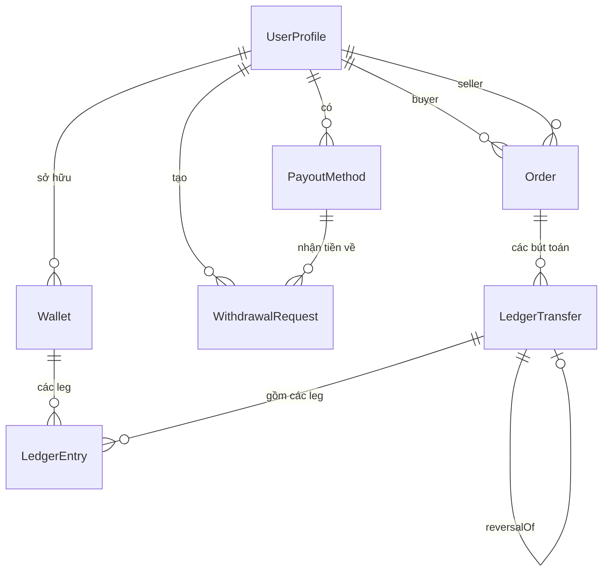

# TNC Web Platform - Database Guide

Tài liệu này mô tả chi tiết database của **TNC Web Platform** (marketplace mỹ
phẩm + ví nội bộ/ledger), bổ sung cho chương đặc tả
[05_Database.md](../Spectification/TNCWebPlatform/05_Database.md). Mục tiêu:

- Hiểu đúng schema, constraint, trigger, view và RLS đang có trong repo.
- Biết cách migrate, kiểm tra bất biến tiền tệ và vận hành/đối soát.
- Là tài liệu tra cứu khi viết module mới (catalog, listing, order, jobs).

> Trạng thái 2026-10-14: toàn bộ nội dung dưới đây **đã có trong repo** và
> được kiểm chứng bằng test tự động trên PostgreSQL thật, trừ các mục ghi rõ ⬜.

## 1. Kiến trúc và nguồn sự thật

```text
NestJS (PrismaClient - role owner `postgres`)
        |
        | DATABASE_URL (transaction pooler 6543, pgbouncer=true)
        v
Supabase Postgres (schema public)
        |
        +-- Bảng nghiệp vụ + bảng tài chính
        +-- Constraints / Triggers / Views (finance_guards.sql)
        +-- RLS default-deny cho anon/authenticated

prisma migrate  ----> DIRECT_URL (port 5432, session-level)
```

Nguồn sự thật của schema là **hai file phải giữ đồng bộ**:

| File | Vai trò |
| ---- | ------- |
| `prisma/schema.prisma` | Định nghĩa model/enum; nguồn để `prisma generate` |
| `prisma/sql/finance_guards.sql` | Toàn bộ constraint/trigger/view/RLS/seed bổ sung - đã **nhúng verbatim** vào `prisma/migrations/20261014053909_finance_core/migration.sql` |

Quy tắc: sửa guards ⇒ phải đưa delta vào một migration (mới hoặc migration hiện
có nếu chưa deploy đi đâu). Test suite chạy `prisma migrate deploy` trên database
trống mỗi lần, nên migration hỏng là test đỏ ngay.

## 2. Sơ đồ quan hệ (ERD)



Ghi chú:

- `UserProfile.id` = `auth.users.id` (đồng bộ bằng trigger `handle_new_auth_user`).
- Ví hệ thống (`ownerId = NULL`, có `code`) không thuộc ERD người dùng.
- `IdempotencyRecord` và `AuditLog` đứng độc lập, không FK.

## 3. Đặc tả bảng

### 3.1. UserProfile

Hồ sơ người dùng, mirror `auth.users`; là nguồn của role nghiệp vụ.

| Cột | Kiểu | Null | Mặc định | Ghi chú |
| --- | ---- | ---- | -------- | ------- |
| id | uuid | PK | - | Bằng `auth.users.id`; mọi bảng domain FK về đây |
| email | text | ✓ | - | Đồng bộ từ auth |
| displayName | text | ✓ | - | Tên hiển thị |
| phone | text | ✓ | - | Số điện thoại |
| role | UserRole | ✗ | USER | USER / STAFF / ADMIN - đọc bởi authz |
| isBlocked | boolean | ✗ | false | Chặn thao tác tiền (FR-04) |
| createdAt / updatedAt | timestamptz(6) | ✗ | now() | UTC |

Index: `@@index([role])`.

### 3.2. Wallet

Ví người dùng và 4 ví hệ thống; số dư là projection của ledger.

| Cột | Kiểu | Null | Mặc định | Ghi chú |
| --- | ---- | ---- | -------- | ------- |
| id | uuid | PK | uuid() | - |
| kind | WalletKind | ✗ | USER | USER / ESCROW / PLATFORM_REVENUE / GATEWAY_CLEARING / WITHDRAWAL_CLEARING |
| ownerId | uuid | ✓ | - | NULL với ví hệ thống; FK UserProfile (Restrict) |
| code | text | ✓ | - | Unique; chỉ ví hệ thống (`ESCROW`, `PLATFORM_REVENUE`, ...) |
| currency | char(3) | ✗ | VND | Chỉ VND ở bản 0.1 |
| balance | numeric(18,2) | ✗ | 0 | **Cache** của `SUM(LedgerEntry.amount)`; chỉ `LedgerService.post()` được ghi |
| version | int | ✗ | 0 | Tăng mỗi lần đổi số dư |
| createdAt / updatedAt | timestamptz(6) | ✗ | now() | - |

Ràng buộc: `@@unique([ownerId, currency])` (mỗi user một ví VND);
`@@index([kind])`; CHECK `wallet_user_balance_non_negative`,
`wallet_escrow_non_negative`, `wallet_owner_or_code`.

### 3.3. LedgerTransfer

Một giao dịch tiền gồm ≥ 2 leg cân bằng.

| Cột | Kiểu | Null | Ghi chú |
| --- | ---- | ---- | ------- |
| id | uuid | PK | - |
| kind | TransferKind | ✗ | DEPOSIT / WITHDRAWAL_REQUEST / WITHDRAWAL_SETTLED / ORDER_PAYMENT / ORDER_RELEASE / ORDER_REFUND / ADJUSTMENT |
| status | TransferStatus | ✗ | POSTED / REVERSED (chỉ đổi được status - trigger) |
| idempotencyKey | text | ✗ | **Unique** - chống trùng ở tầng DB (`deposit:{gatewayRef}`, `order-payment:{orderId}`, ...) |
| orderId | uuid | ✓ | FK Order (Restrict); null với deposit/withdrawal |
| externalRef | text | ✓ | Mã giao dịch PSP/ngân hàng; không unique |
| description | text | ✓ | Mô tả cho statement |
| reversalOfId | uuid | ✓ | Unique; trỏ transfer gốc khi là transfer đảo |
| createdBy | uuid | ✓ | Actor từ JWT; null cho system/job |
| createdAt | timestamptz(6) | ✗ | - |

Index: `[orderId]`, `[kind, createdAt]`, `[externalRef]`.

### 3.4. LedgerEntry

Từng leg có dấu; append-only.

| Cột | Kiểu | Null | Ghi chú |
| --- | ---- | ---- | ------- |
| id | uuid | PK | - |
| transferId | uuid | ✗ | FK LedgerTransfer (Restrict) |
| walletId | uuid | ✗ | FK Wallet (Restrict) |
| amount | numeric(18,2) | ✗ | Âm = ghi nợ ví, dương = ghi có; ≠ 0 |
| balanceAfter | numeric(18,2) | ✗ | Số dư ví ngay sau leg (lấy từ `RETURNING` của guarded UPDATE) |
| createdAt | timestamptz(6) | ✗ | - |

Ràng buộc: `@@unique([transferId, walletId])` (một ví xuất hiện tối đa một lần
trong một transfer); `@@index([walletId, createdAt(desc)])`; CHECK
`ledger_entry_amount_not_zero`, `ledger_entry_whole_dong`.

### 3.5. Order

Đơn B2C/C2C; hiện là bảng "stub" đủ cho luồng escrow (module order sẽ mở rộng
bằng migration mới: items, shipping, ảnh, tình trạng...).

| Cột | Kiểu | Null | Ghi chú |
| --- | ---- | ---- | ------- |
| id | uuid | PK | - |
| code | text | ✗ | Unique; mã đơn hiển thị (`TNC-YYYYMMDD-xxxx`) |
| buyerId | uuid | ✗ | FK UserProfile (Restrict) |
| sellerId | uuid | ✓ | NULL = đơn B2C của TNC |
| grossAmount | numeric(18,2) | ✗ | Số tiền buyer trả |
| commissionAmount | numeric(18,2) | ✗ | Chốt tại checkout; `sellerAmount = gross - commission` |
| status | OrderStatus | ✗ | PENDING_PAYMENT → PAID → READY_TO_SHIP → SHIPPED → DELIVERED → COMPLETED; nhánh CANCELLED / REFUNDED / DISPUTED |
| paidAt / releasedAt | timestamptz(6) | ✓ | Mốc thời gian thanh toán/release |
| version | int | ✗ | Tăng khi cập nhật (optimistic) |
| createdAt / updatedAt | timestamptz(6) | ✗ | - |

Index: `[buyerId, createdAt desc]`, `[sellerId, createdAt desc]`, `[status]`.
CHECK `order_amounts_sane` (0 ≤ commission ≤ gross; cả hai whole-đồng).

### 3.6. PayoutMethod

Tài khoản nhận tiền của người dùng (số tài khoản chỉ lưu bản che để hiển thị;
số đầy đủ xử lý theo quy trình riêng).

| Cột | Kiểu | Null | Ghi chú |
| --- | ---- | ---- | ------- |
| id | uuid | PK | - |
| ownerId | uuid | ✗ | FK UserProfile (Cascade) |
| bankCode | text | ✗ | Mã ngân hàng (VCB, TCB...) |
| accountNumberMasked | text | ✗ | Dạng `****1234` |
| accountHolder | text | ✗ | Chủ tài khoản |
| isVerified | boolean | ✗ | Xác minh danh tính (⬜ quy trình) |
| createdAt | timestamptz(6) | ✗ | - |

### 3.7. WithdrawalRequest

Lệnh rút tiền + vòng đời duyệt.

| Cột | Kiểu | Null | Ghi chú |
| --- | ---- | ---- | ------- |
| id | uuid | PK | - |
| userId | uuid | ✗ | FK UserProfile (Restrict) |
| payoutMethodId | uuid | ✗ | FK PayoutMethod (Restrict) |
| amount | numeric(18,2) | ✗ | > 0, whole đồng (CHECK) |
| status | WithdrawalStatus | ✗ | REQUESTED → APPROVED → SETTLED; hoặc REJECTED / FAILED |
| reviewedBy / reviewedAt | uuid / timestamptz | ✓ | Staff thao tác |
| reason | text | ✓ | Lý do (reject/fail) |
| createdAt / updatedAt | timestamptz(6) | ✗ | - |

Index: `[userId, createdAt desc]`, `[status]`.

### 3.8. IdempotencyRecord

Chống trùng cho endpoint POST không sinh transfer (⬜ chưa có service dùng).

| Cột | Kiểu | Null | Ghi chú |
| --- | ---- | ---- | ------- |
| key | text | PK | `Idempotency-Key` từ client |
| userId | uuid | ✗ | Scope theo user |
| endpoint | text | ✗ | Phân biệt ngữ cảnh |
| requestHash | text | ✗ | Hash payload; khác payload ⇒ 409 |
| state | IdempotencyState | ✗ | IN_PROGRESS / COMPLETED |
| statusCode / responseBody | int / json | ✓ | Replay đúng response cũ |
| createdAt / expiresAt | timestamptz(6) | ✗ | Dọn định kỳ theo `expiresAt` |

### 3.9. AuditLog

Audit trail thay đổi trạng thái nghiệp vụ (⬜ aspect wiring).

| Cột | Kiểu | Null | Ghi chú |
| --- | ---- | ---- | ------- |
| id | uuid | PK | - |
| entityType / entityId | text | ✗ | Ví dụ `Order` / id |
| action | text | ✗ | `APPROVE`, `REJECT`, `SHIP`, `RELEASE`, `SETTLE`... |
| oldStatus / newStatus | text | ✓ | Chuyển trạng thái |
| reason | text | ✓ | Bắt buộc cho reject/refund/adjustment |
| actorId / actorRole | uuid / text | ✓ | Người thực hiện |
| ipAddress / userAgent | text | ✓ | Ngữ cảnh request |
| metadata | json | ✓ | Dữ liệu bổ sung (tracking code, ticket...) |
| occurredAt | timestamptz(6) | ✗ | - |

Index: `[entityType, entityId, occurredAt desc]`, `[actorId, occurredAt desc]`.

### 3.10. Enums

| Enum | Giá trị |
| ---- | ------- |
| UserRole | USER, STAFF, ADMIN |
| WalletKind | USER, PLATFORM_REVENUE, ESCROW, GATEWAY_CLEARING, WITHDRAWAL_CLEARING |
| TransferKind | DEPOSIT, WITHDRAWAL_REQUEST, WITHDRAWAL_SETTLED, ORDER_PAYMENT, ORDER_RELEASE, ORDER_REFUND, ADJUSTMENT |
| TransferStatus | POSTED, REVERSED |
| OrderStatus | PENDING_PAYMENT, PAID, READY_TO_SHIP, SHIPPED, DELIVERED, COMPLETED, CANCELLED, REFUNDED, DISPUTED |
| WithdrawalStatus | REQUESTED, APPROVED, SETTLED, REJECTED, FAILED |
| IdempotencyState | IN_PROGRESS, COMPLETED |
| ShopeeItemStatus | NORMAL, UNLIST, BANNED, DELETED, NOT_SEEN |
| SyncProvider | CSV, AFFILIATE, OPEN_PLATFORM |
| SyncMode | FULL, INCREMENTAL, MANUAL_IMPORT |
| SyncRunStatus | RUNNING, SUCCEEDED, FAILED, PARTIAL |

### 3.11. Catalog đồng bộ Shopee (thêm 2026-10-14, migration `20261014071511_add_shopee_sync_catalog`)

Shopee là nguồn sự thật cho dữ liệu thương mại; các bảng dưới đây là bản mirror
để showroom đọc mà không gọi Shopee mỗi request. Sync **không bao giờ xoá cứng**.

| Bảng | Vai trò | Ghi chú |
| ---- | ------- | ------- |
| `ShopeeShop` | Gian hàng Shopee (`shopeeShopId` unique) | `lastSyncAt` cập nhật mỗi lần sync |
| `ShopeeItem` | Item mirror: tên, giá, giá min/max, tồn, ảnh, mô tả, trạng thái | `@@unique(shopId, itemId)`; `contentHash` (sha256) phát hiện thay đổi thật; `raw` audit lần sync gần nhất; `firstSeenAt`/`lastSeenAt` |
| `ShopeeItemModel` | Phân loại (variant) của item | `modelId` là chuỗi (ID số của Shopee hoặc SKU người bán đặt); unique theo `(itemRef, modelId)` |
| `SyncRun` | Một lần sync: provider, mode, status, stats (JSON), người chạy, file gốc | `stats = { receivedRows, itemsParsed, created, updated, unchanged, errors, notSeen }` |
| `SyncError` | Lỗi từng dòng của một run | `itemRef` = số dòng dữ liệu (1-based, không tính header) |

Quy tắc trạng thái: export vắng item ⇒ `NOT_SEEN` (không xoá); item xuất hiện
lại ⇒ quay về trạng thái nguồn; `BANNED`/`DELETED` là trạng thái cuối, không bị
đánh `NOT_SEEN`. Chi tiết: [../backend/SHOPEE_SHOWROOM_BACKEND.md](../backend/SHOPEE_SHOWROOM_BACKEND.md).

## 4. Guards và bất biến (đã có trong migration)

Danh sách đầy đủ trong `prisma/sql/finance_guards.sql`. Bảng tóm tắt:

| Guard | Loại | Bảo vệ điều gì | Test chứng minh |
| ----- | ---- | -------------- | --------------- |
| `assert_transfer_balanced` | Deferred constraint trigger (COMMIT) | Mọi transfer ≥ 2 leg và tổng = 0 - không thể tạo/hủy tiền | transfer lệch/1 leg/leg trùng/0 đồng đều không commit được |
| `reject_ledger_mutation` | Trigger | `LedgerEntry` bất biến: cấm UPDATE/DELETE | sổ append-only |
| `restrict_transfer_update` | Trigger | `LedgerTransfer` chỉ được đổi `status` | - |
| `wallet_user_balance_non_negative` | CHECK | Ví USER không bao giờ âm | mua đồng thời, hai đơn tranh tiền |
| `wallet_escrow_non_negative` | CHECK | Escrow không bao giờ âm (chốt cuối của escrow isolation) | escrow isolation |
| `wallet_owner_or_code` | CHECK | Ví user phải có owner; ví hệ thống phải có code | - |
| `ledger_entry_amount_not_zero` | CHECK | Leg 0 đồng là bug | test guards |
| `ledger_entry_whole_dong` | CHECK | Không có phần lẻ đồng | test guards |
| `order_amounts_sane` / `withdrawal_amount_positive` | CHECK | Số tiền đơn/lệnh rút hợp lệ, whole đồng | - |
| `@@unique([transferId, walletId])` | Unique | Một ví tối đa một leg trong transfer | test duplicate leg |
| `@@unique([ownerId, currency])` | Unique | Mỗi user một ví VND | provisioning |
| RLS + revoke + default privileges deny | Bảo mật | `anon`/`authenticated` không chạm được bảng tài chính | test RLS |

### 4.1. Guarded UPDATE - trái tim của tính đúng đắn

Mỗi leg được áp bằng **một câu UPDATE duy nhất** (kiểm tra và ghi trong cùng
statement):

```sql
UPDATE "Wallet"
   SET balance = balance + :delta, version = version + 1, "updatedAt" = now()
 WHERE id = :id
   AND (kind <> 'USER' OR balance + :delta >= 0)
RETURNING id, balance
```

0 dòng bị ảnh hưởng = thiếu tiền hoặc không có ví ⇒ service ném domain error và
transaction rollback toàn bộ. Leg được sắp xếp theo `walletId` trước khi áp để
tránh deadlock khi hai transfer chạm cùng cặp ví.

### 4.2. Trigger cân bằng

```sql
create or replace function public.assert_transfer_balanced()
returns trigger language plpgsql as $$
declare
  leg_total numeric(18,2);
  leg_count integer;
begin
  select coalesce(sum(amount), 0), count(*)
    into leg_total, leg_count
    from public."LedgerEntry"
   where "transferId" = new."transferId";

  if leg_count < 2 then
    raise exception 'transfer % has only % leg(s); a transfer needs at least 2',
      new."transferId", leg_count using errcode = 'check_violation';
  end if;

  if leg_total <> 0 then
    raise exception 'transfer % is unbalanced: sum(amount) = %',
      new."transferId", leg_total using errcode = 'check_violation';
  end if;

  return null;
end;
$$;
```

Trigger là `constraint trigger ... deferrable initially deferred` nên check chỉ
chạy **một lần tại COMMIT** - service được phép insert từng leg trong transaction.

### 4.3. Views đối soát

```sql
-- WalletReconciliation: số dư cache vs ledger
select w.id as wallet_id, w.kind, w.code, w."ownerId" as owner_id,
       w.balance as cached_balance,
       coalesce(sum(e.amount), 0) as ledger_balance,
       w.balance - coalesce(sum(e.amount), 0) as drift
  from public."Wallet" w
  left join public."LedgerEntry" e on e."walletId" = w.id
 group by w.id, w.kind, w.code, w."ownerId", w.balance;

-- LedgerIntegrity: tổng toàn sổ cái phải bằng 0
select coalesce(sum(amount), 0) as total_drift, count(*) as entry_count
  from public."LedgerEntry";
```

### 4.4. Seed ví hệ thống (trong migration)

```sql
insert into public."Wallet" (id, kind, code, "ownerId", currency, balance, version, "createdAt", "updatedAt")
values
  (gen_random_uuid(), 'ESCROW',              'ESCROW',              null, 'VND', 0, 0, now(), now()),
  (gen_random_uuid(), 'PLATFORM_REVENUE',    'PLATFORM_REVENUE',    null, 'VND', 0, 0, now(), now()),
  (gen_random_uuid(), 'GATEWAY_CLEARING',    'GATEWAY_CLEARING',    null, 'VND', 0, 0, now(), now()),
  (gen_random_uuid(), 'WITHDRAWAL_CLEARING', 'WITHDRAWAL_CLEARING', null, 'VND', 0, 0, now(), now())
on conflict (code) do nothing;
```

## 5. RLS và bảo mật tầng database

Nguyên tắc: `prisma migrate` tạo bảng bằng DDL thường (không bật RLS), trong khi
Supabase mặc định cấp quyền cho `anon`/`authenticated` và PostgREST phơi schema
`public` ra internet. Vì vậy guards bật RLS + revoke + chặn default privileges:

```sql
alter table public."Wallet" enable row level security;
-- ... (toàn bộ bảng tài chính: LedgerEntry, LedgerTransfer, Order, PayoutMethod,
--      WithdrawalRequest, IdempotencyRecord, AuditLog, UserProfile)

revoke all on table public."Wallet", public."LedgerEntry", ... from anon, authenticated;

alter default privileges for role postgres in schema public
  revoke all on tables from anon, authenticated;
```

- RLS bật với **0 policy** = default-deny với mọi role không phải owner.
- Prisma kết nối bằng role owner (`postgres`) nên owner bypass RLS - service
  không bị ảnh hưởng.
- **Không** dùng `force row level security` (sẽ khoá Prisma khỏi bảng của chính
  nó).
- `anon`/`authenticated` được tạo tự động nếu thiếu (bare PostgreSQL/CI).

### 5.1. Diagnostic bắt buộc trước go-live

```sql
select relname, relrowsecurity as rls_enabled
  from pg_class
 where relnamespace = 'public'::regnamespace and relkind = 'r'
 order by relname;

select table_name, grantee, privilege_type
  from information_schema.role_table_grants
 where table_schema = 'public'
   and grantee in ('anon', 'authenticated')
 order by table_name, grantee;
```

Kỳ vọng: `rls_enabled = true` cho toàn bộ bảng; `anon`/`authenticated` không có
bất kỳ quyền nào trên bảng tài chính. Nếu sai ⇒ xử lý như sự cố đang xảy ra và
chạy lại mục 1 của `finance_guards.sql`.

### 5.2. Mở bảng công khai cho frontend (khi làm catalog)

Chỉ với bảng **không nhạy cảm**, và phải là hành động tường minh có review:

```sql
grant select on public."Product" to anon, authenticated;
alter table public."Product" enable row level security;
create policy product_public_read on public."Product" for select using (true);
```

Bảng tiền/đơn/lệnh rút/audit **không bao giờ** mở theo cách này.

## 6. Provisioning user mới

Trigger `handle_new_auth_user()` (security definer, `search_path = public`) chạy
sau mỗi INSERT trên `auth.users`:

- insert `UserProfile` (id, email, phone) `on conflict do nothing`;
- insert ví `USER` VND balance 0 `on conflict ("ownerId", currency) do nothing`.

Trên Supabase, trigger được cài bởi migration khi role migrate đủ quyền; nếu
không, migration chỉ `raise notice` và cần chạy **mục 7** của
`finance_guards.sql` một lần bằng SQL editor. Kiểm tra sau khi chạy:

```sql
select tgname from pg_trigger where tgrelid = 'auth.users'::regclass and not tgisinternal;
-- kỳ vọng: on_auth_user_created
```

## 7. Quy trình migration

```bash
# 1. Sửa prisma/schema.prisma (hoặc guards) rồi tạo migration rỗng để tự viết SQL
npx prisma migrate dev --create-only --name them_bang_catalog

# 2. Review SQL trong prisma/migrations/<timestamp>_.../migration.sql
#    (nếu đổi guards: copy delta vào đây, giữ đồng bộ với finance_guards.sql)

# 3. Áp lên môi trường (staging trước, production sau >= 24h)
npx prisma migrate deploy        # dùng DIRECT_URL

# 4. Sinh client
npx prisma generate
```

Chính sách:

- Migration là **nguồn duy nhất**; không `db push` lên project thật, không sửa
  tay bằng SQL editor.
- Không sửa migration đã áp dụng; thay đổi tiếp theo là migration mới.
- Test e2e (`npm run test:e2e`) tự chạy `prisma migrate deploy` trên database
  trống mỗi lần ⇒ migration hỏng bị phát hiện ngay.

Ghi chú harness test (không cần cấu hình gì):

- `test/setup/pg-harness.ts` tự dựng PostgreSQL 18 cục bộ bằng `initdb` tại
  `%TEMP%\tnc-pg-test-data`, cổng `55432`, trust auth; drop/recreate database
  `tnc_test` rồi `prisma migrate deploy`.
- Muốn dùng database sẵn có (CI service container): đặt biến
  `TEST_DATABASE_URL`; harness sẽ dùng thay vì tự dựng.
- Jest chạy với `node --experimental-vm-modules` (NestJS 12 ESM) - đã đóng gói
  trong `npm run test:e2e`.

## 8. Vận hành và đối soát

Chạy định kỳ (khuyến nghị mỗi giờ, qua job ⬜):

```sql
-- 1. Bất biến toàn cục: phải luôn total_drift = 0
select * from "LedgerIntegrity";

-- 2. Drift của từng ví: kết quả phải RỖNG
select * from "WalletReconciliation" where drift <> 0;

-- 3. Đối chiếu tiền nạp từ thế giới bên ngoài với sao kê PSP:
select -balance as net_funded from "Wallet" where code = 'GATEWAY_CLEARING';

-- 4. Lệnh rút đang trên đường ra ngân hàng:
select sum(amount) as in_flight from "WithdrawalRequest" where status = 'APPROVED';
```

Kiểm tra một user (khi có khiếu nại):

```sql
-- Sổ giao dịch keyset (20 dòng mới nhất) - cùng shape API /wallet/statement
select e.id, t.kind, t.description, e.amount, e."balanceAfter", e."createdAt"
  from "LedgerEntry" e
  join "LedgerTransfer" t on t.id = e."transferId"
 where e."walletId" = (select id from "Wallet" where "ownerId" = :userId and currency = 'VND')
 order by e."createdAt" desc, e.id desc
 limit 20;

-- Ví dụ "đi ngược": cộng dồn amount từ đầu tới nay phải bằng balance
select w.balance as cached,
       (select coalesce(sum(e.amount), 0) from "LedgerEntry" e where e."walletId" = w.id) as ledger
  from "Wallet" w where w."ownerId" = :userId and w.currency = 'VND';
```

Quy tắc vận hành:

- Drift ≠ 0 ⇒ **cảnh báo + điều tra**, tuyệt đối không "UPDATE số dư cho khớp".
- Sai sót đã xác minh ⇒ transfer đảo (`reverse`) hoặc `ADJUSTMENT` (ADMIN, có
  lý do, audit).
- `LedgerIntegrity.total_drift ≠ 0` là sự cố nghiêm trọng: tạm dừng thao tác
  tiền, khoanh vùng transfer gần nhất, đối chiếu audit.

## 9. Xử lý sự cố thường gặp

| Triệu chứng | Nguyên nhân thường gặp | Xử lý |
| ----------- | ---------------------- | ----- |
| `prepared statement "s0" already exists` ngẫu nhiên dưới tải | Thiếu `?pgbouncer=true` trong `DATABASE_URL` | Bật lại tham số (đã có trong `.env.example`) |
| `prisma migrate` fails | Thiếu `DIRECT_URL` hoặc trỏ nhầm pooler | Đặt `DIRECT_URL` port 5432 (direct) |
| `role "anon" does not exist` khi chạy guards | Database không phải Supabase | Không sao - guards tự tạo role NOLOGIN; chạy đúng file guards |
| Trigger `on_auth_user_created` không tồn tại trên Supabase | Migration thiếu quyền trên schema `auth` | Chạy mục 7 của `finance_guards.sql` bằng SQL editor; kiểm tra lại bằng query ở mục 6 |
| `Unique constraint failed on idempotencyKey` | Replay hợp lệ (webhook retry/double-click) | Mong đợi - service sẽ tra lại và trả kết quả cũ; nếu khác payload thì là bug |
| Lỗi `check_violation: transfer ... is unbalanced` | Bug logic (quên leg hoa hồng/hoàn tiền) | Không retry mù; đọc log transferId, sửa logic; test sẽ chặn trước khi lên production |
| Ví user không tồn tại khi giao dịch | User tạo trước khi trigger provisioning được cài | Chạy mục 7 guards; backfill ví cho user cũ (migration/script riêng) |

## 10. Việc còn lại

| # | Việc | Trạng thái |
| - | ---- | ---------- |
| 1 | Chạy 2 câu diagnostic RLS trên Supabase project thật | ⬜ (việc đầu tiên trước mọi thứ) |
| 2 | Migration bảng catalog/listing/order chi tiết (items, shipping, ảnh, condition, flash sale) | ⬜ |
| 3 | Service dùng `IdempotencyRecord` + job dọn hết hạn | ⬜ |
| 4 | Job đối soát drift + alert | ⬜ |
| 5 | Backfill script cho user tạo trước khi có trigger provisioning (nếu có) | ⬜ |
